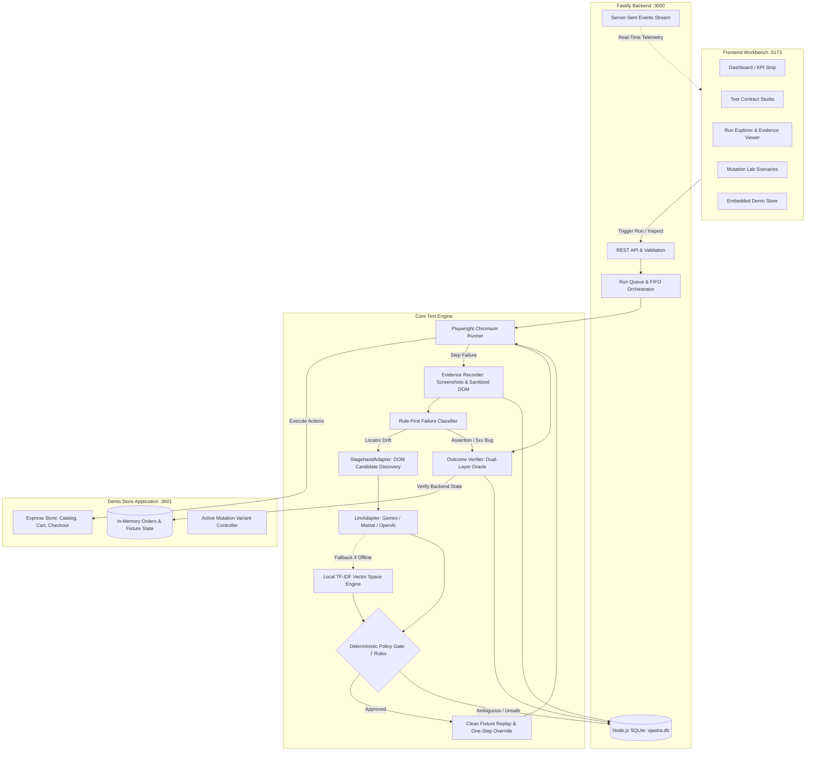

<div align="center">


# Ojastra

### Evidence-Gated, Self-Healing E2E Test Automation Workbench

**"The UI may change. The test's definition of correctness must never soften just to make a test green."**

[](https://nodejs.org)
[](https://pnpm.io)
[](https://www.typescriptlang.org)
[](https://playwright.dev)
[](https://fastify.dev)
[](https://react.dev)
[](https://vitejs.dev)
[](https://nodejs.org/api/sqlite.html)

</div>

---

## 📌 Overview

**Ojastra** is a deterministic, self-healing end-to-end testing workbench designed for mission-critical web applications. Unlike traditional testing tools that fail on minor locator changes or unconstrained AI agents that hallucinate invalid actions, Ojastra enforces **immutable intent contracts**, **rule-first failure diagnostics**, **constrained candidate discovery**, **deterministic policy gating**, **clean fixture replays**, and **independent dual-layer test oracles**.

When an interface drifts, Ojastra never soft-pedals correctness or modifies test assertions. If the drift is harmless (e.g. a renamed button or restructured DOM layout), it discovers visible candidates, selects the matching action, verifies it against 7 strict safety rules, resets test fixtures, replays the workflow from a clean baseline, and independently checks both UI banners and backend database state. If the failure is a real defect (such as an incorrect pricing calculation or payment error), Ojastra strictly refuses to heal and fails closed.

---

## ⚡ Core Architectural Pillars

### 1. Immutable Intent Contracts
Each test workflow is locked to a strictly typed [Zod](https://zod.dev) contract containing preconditions, ordered steps with risk ratings, business invariants, and machine-checkable success conditions. Recovery engines are barred from softening assertions, adding unauthorized steps, or altering invariants.

### 2. Rule-First Failure Classification
Before triggering any recovery attempt, the engine evaluates the runtime error against deterministic rules:
- **`LOCATOR_DRIFT`**: Page is interactive, but target locator timed out. *Eligible for candidate discovery.*
- **`ASSERTION_OR_BUSINESS_INVARIANT`**: Business assertion or pricing mismatch. *Non-recoverable; marked `FAILED`.*
- **`APPLICATION_OR_NETWORK_ERROR`**: HTTP 5xx, service crash, or offline application. *Non-recoverable; marked `FAILED`.*
- **`AMBIGUOUS_OR_UNKNOWN`**: Multiple matching elements or unknown failure. *Fails closed to `REVIEW_REQUIRED`.*

### 3. In-Browser Candidate Discovery (`StagehandAdapter`)
During locator drift, the engine injects a DOM observation adapter directly into the active Playwright page. It enumerates visible, interactable elements matching the action type (`click`, `fill`, etc.) and extracts structured metadata:
- Unique identifier (`cand_01`, `cand_02`)
- Semantic role (`button`, `link`, `input`)
- Visible inner text, `aria-label`, and element name
- Bounding box coordinates and visibility state
- Uniqueness flag (detects whether duplicate labels exist)
- Section hierarchy context (`header`, `main`, `form`, `section`)

### 4. Dual-Mode Recovery Intelligence (Cloud LLM + Local Vector Engine)
Ojastra operates across multiple LLM providers or completely offline:
- **Google Gemini**: Native REST API with structured JSON output schema (supported via Google AI Studio).
- **OpenAI / Mistral**: OpenAI-compatible chat completion endpoints with JSON mode.
- **In-Memory TF-IDF & Cosine Similarity Engine (`SemanticVectorEngine`)**: Built-in mathematical vector space engine with domain synonym expansion and bigram tokenization. If cloud LLMs are unavailable, unconfigured, or timed out, the engine cascades seamlessly to the local vector engine without failing.

### 5. Deterministic Policy Gate (7 Invariant Checks)
Every proposed candidate is evaluated deterministically against 7 safety invariants before browser execution:
1. **Decision Integrity**: If the model proposed `NO_SAFE_MATCH`, transition immediately to `REVIEW_REQUIRED`.
2. **Attempt Bounding**: Strictly maximum 1 recovery attempt per step.
3. **Observation Verification**: Candidate ID must physically exist in the current page observation snapshot.
4. **Interactability Check**: Target must be visible (`width > 0, height > 0`) and enabled in the DOM.
5. **Non-Destructive Action Policy**: Rejects destructive actions containing keywords like `delete`, `cancel`, `remove`, `trash`, or `abandon`.
6. **Uniqueness Enforcement**: Candidates with duplicate labels or ambiguous roles fail closed to `REVIEW_REQUIRED`.
7. **Action Compatibility**: The proposed action type (`click`, `fill`) must match the contract step action type.

### 6. Clean Fixture Replay
Ojastra **never** resumes execution from a dirty, half-executed state. Once a candidate is approved:
1. The backend application fixtures are reset to clean baseline via `/api/fixtures/reset`.
2. The browser navigates back to the initial starting URL.
3. The entire workflow replays from step 1 with exactly one bounded step locator override.

### 7. Independent Outcome Verifier (Test Oracle)
After workflow execution, the test oracle independently verifies all machine-checkable success conditions:
- **UI State**: Banner visibility (`#confirmed-order-id`, `[data-testid='confirmation-banner']`) and URL path match.
- **Backend Database State**: Directly queries the application's order API (`/api/orders/:id` and `/api/orders`) to verify exact SKU (`SKU-PROD-001`), quantity (`1`), verified total price (`$54.00`), payment status (`approved`), and duplicate order prevention (`count === 1`).

---

## 🏛️ System Architecture



---

## 📁 Repository Structure

```
d:/LEXIQUE/
├── apps/
│   ├── web/                          # React 18 + TypeScript + Vite Workbench UI (:5173)
│   │   ├── src/views/
│   │   │   ├── DashboardView.tsx     # KPI metrics, scenario breakdowns, run telemetry
│   │   │   ├── TestEditorView.tsx    # Visual test contract editor & Playwright code generator
│   │   │   ├── RunExplorerView.tsx   # Step timeline, screenshots, DOM viewer, recovery inspector
│   │   │   ├── MutationLabView.tsx   # 8-scenario mutation suite & live benchmark table
│   │   │   ├── DemoAppView.tsx       # Live embedded sandbox preview of the demo store
│   │   │   └── SettingsView.tsx      # Engine status, LLM config, database clear-slate
│   │   ├── src/components/           # Status badges, live execution overlay, logo, header
│   │   └── src/api.ts                # REST client & EventSource SSE subscriber
│   └── api/                          # Fastify 5 REST API & Event Stream (:3000)
│       └── src/
│           ├── server.ts             # REST endpoints, SQLite queries, benchmark analytics
│           ├── queue.ts              # In-memory execution queue coordinator
│           └── sse.ts                # Server-Sent Events client connection manager
├── packages/
│   ├── contracts/                    # Shared Zod schemas & TypeScript types
│   │   ├── test-spec.schema.ts       # TestContract, WorkflowStep, Invariant, SuccessCondition
│   │   ├── failure.schema.ts         # FailureCategory, FailureClassification
│   │   ├── recovery-proposal.schema.ts # ObservedCandidate, RecoveryProposal, PolicyEvaluationResult
│   │   ├── run-event.schema.ts       # RunStatus, EventType, RunEvent, VerificationCheckResult
│   │   ├── mutation.schema.ts        # MutationScenario definitions
│   │   └── api.schema.ts             # Request & response contracts
│   └── engine/                       # Core test execution and healing engine
│       ├── orchestrator.ts           # State machine lifecycle coordinator
│       ├── failure-classifier.ts     # Deterministic rule-first error classifier
│       ├── stagehand-adapter.ts      # In-browser DOM candidate extraction via Playwright
│       ├── llm-adapter.ts            # Gemini/OpenAI/Mistral structured JSON adapter
│       ├── semantic-vsm.ts           # Built-in TF-IDF & Cosine Similarity vector engine
│       ├── recovery-policy.ts        # Deterministic 7-rule policy validation gate
│       ├── outcome-verifier.ts       # Independent dual-layer UI & backend verification oracle
│       ├── evidence-recorder.ts      # PNG screenshots & sanitized DOM capture
│       ├── db.ts                     # Native node:sqlite database configuration & schema
│       ├── seed.ts                   # Canonical baseline contract & 8 mutation scenarios
│       └── config.ts                 # Environment variable configuration parser
├── demo-app/                         # Express eCommerce store under test (:3001)
│   └── src/
│       ├── server.ts                 # Catalog, Cart (with 8 mutation variants), Checkout, Confirmation
│       └── store.ts                  # In-memory catalog, shopping cart, orders, and reset handlers
├── tests/                            # Automated acceptance suite
│   └── e2e/workbench.test.ts         # 5 comprehensive Vitest integration & healing tests
├── storage/                          # SQLite database (ojastra.db) and run artifacts
├── FRONTEND.md                       # Comprehensive workbench UI & frontend architecture guide
├── showcase.ps1                      # Automated PowerShell showcase script
├── pnpm-workspace.yaml               # Monorepo workspace configuration
├── tsconfig.base.json                # Shared TypeScript compiler settings
└── package.json                      # Workspace root scripts
```

---

## 🧪 Mutation Lab Scenario Catalog

Ojastra is evaluated against 8 real mutation scenarios implemented in the demo application (`demo-app/src/server.ts`). Each scenario tests a distinct category of interface drift or backend defect:

| Scenario ID | Mutation Scenario | Injected Change in Demo App | Expected Outcome | Safety & Verification Mechanism |
|---|---|---|---|---|
| `M01_RENAME_TARGET` | **Rename Checkout Button** | Changes label `Checkout` &rarr; `Place order`, changes button `id` and classes | `HEALED` | Classified as `LOCATOR_DRIFT`. Candidate observed by `StagehandAdapter`, selected by AI/VSM, validated by Policy Gate, replayed from clean fixtures, and verified by Oracle. |
| `M02_RESTRUCTURE_DOM` | **Restructure DOM Hierarchy** | Wraps checkout button inside 3 nested container `div`s, updating selectors | `HEALED` | Playwright locator times out. `StagehandAdapter` locates candidate inside nested slots, policy verifies uniqueness, and replay passes. |
| `M03_MOVE_TARGET` | **Relocate Action Section** | Moves checkout action into a distinct floating card below cart summary | `HEALED` | Classified as `LOCATOR_DRIFT`. Model maps intent to relocated section, policy approves, and test oracle verifies backend order. |
| `M04_ADD_REVIEW_STEP` | **Inject Intermediate Review Step** | Injects an uncontracted review page between cart summary and checkout | `REVIEW_REQUIRED` | Injected step requires uncontracted transition. Engine abstains from arbitrary navigation and fails closed for human review. |
| `M05_DUPLICATE_LABEL` | **Duplicate Action Labels** | Renders two identical "Place order" buttons (Express vs Standard) | `REVIEW_REQUIRED` | `StagehandAdapter` detects non-unique elements (`isUnique === false`). Policy Rule 5 rejects ambiguous targets without guessing. |
| `M06_WRONG_TOTAL` | **Seed Incorrect Order Total** | Backend charges `$64.00` instead of contract price `$54.00` *(Real Bug!)* | `FAILED` | Workflow executes, but Outcome Verifier detects `order_total_match` mismatch against backend database. Recovery strictly refused (0 false heals). |
| `M07_PAYMENT_ERROR` | **Seed Mock Payment Failure** | Mock gateway returns payment declined *(Real Bug!)* | `FAILED` | Outcome Verifier flags `payment_status_match` failure. Engine refuses to mark a defective flow green. |
| `M08_SERVER_UNAVAILABLE` | **Force 503 Service Crash** | Backend crashes order processing route with HTTP 503 *(Infrastructure Bug!)* | `FAILED` | Classifier detects HTTP 503. Classified as `APPLICATION_OR_NETWORK_ERROR`. Bypasses candidate discovery entirely. |

---

## 🖥️ Workbench User Interface

> For comprehensive architectural and operational documentation covering all frontend views, state management, SSE real-time streaming, and design tokens, see **[FRONTEND.md](./FRONTEND.md)**.

The React workbench (`http://localhost:5173`) provides six dedicated views:

1. **Dashboard (`DashboardView.tsx`)**:
   - Live KPI cards: Total Runs, Healed Count, Passed Count, Failed Count, Review Required Count.
   - Reliability metrics: Benign Recovery Rate, False Heal Rate, Safe Abstention Rate, Model Invocations.
   - Scenario accuracy breakdown table showing empirical sample counts and percentages.
   - Quick Action buttons: Run Baseline Test, Clear All Runs, Run Scenarios.
2. **Contract Studio (`TestEditorView.tsx`)**:
   - Visual test contract inspector and editor.
   - Step-by-step breakdown displaying step intent, action type, target locator, risk tier, and auto-generated Playwright code snippets.
   - Contract Preconditions, Invariants, and Machine-Checkable Success Conditions.
   - Live URL ping utility to test connectivity to target applications.
   - Raw JSON contract viewer.
3. **Run Explorer (`RunExplorerView.tsx`)**:
   - Historical run sidebar filterable by status (`PASSED`, `HEALED`, `FAILED`, `REVIEW_REQUIRED`) and mutation scenario.
   - Step timeline showing individual execution states, attempts (baseline vs replay), and millisecond durations.
   - **Evidence Viewer**: Fullscreen modal viewer for high-resolution PNG screenshots and sanitized JSON DOM trees.
   - **Failure Diagnostic Panel**: Category badge, confidence percentage, and extracted runtime signals.
   - **Recovery Attempt Inspector**: Observed candidate table, model proposal rationale, policy decision, reason codes, and model latency.
   - **Outcome Verifier Results**: Machine-checkable checks against UI elements and backend database fields.
   - **"Commit Healed Locator" Button**: One-click action to update the test spec contract to a new version with the healed selector.
4. **Mutation Lab (`MutationLabView.tsx`)**:
   - Catalog of all 8 mutation scenarios with risk ratings and descriptions.
   - One-click scenario runner and fixture reset controls.
   - Live empirical benchmark table tracking scenario accuracy and outcomes.
5. **Demo App Sandbox (`DemoAppView.tsx`)**:
   - Embedded interactive iframe of the live demo store (`http://localhost:3001`).
   - Allows judges and engineers to inspect catalog items, cart variations, and order creation manually.
6. **Settings (`SettingsView.tsx`)**:
   - Telemetry for active LLM provider, API endpoints, model names, and timeouts.
   - SQLite database path and on-disk artifact storage metrics.
   - Clean-slate reset button to clear test runs and artifacts.

---

## 🚀 Quick Start Guide

### 1. Prerequisites
- **Node.js**: v20+, v22+, or v24+ (uses built-in `node:sqlite`)
- **pnpm**: v9+ or v10+
- **Playwright Chromium**: installed via `npx playwright install chromium`

### 2. Environment Configuration
Clone the repository and copy the environment template:
```bash
cp .env.example .env
```

Edit `.env` to configure your preferred LLM provider:
```env
PORT=3000
DEMO_PORT=3001
WEB_PORT=5173

# LLM Provider: 'gemini' (Recommended - 100% Free with Google AI Studio), 'mistral', 'openai', or 'vector-engine'
LLM_PROVIDER=gemini

# 1. Google Gemini (Free tier available at https://aistudio.google.com)
GEMINI_API_KEY=your_gemini_api_key_here
GEMINI_MODEL=gemini-3.8-flash

# 2. Mistral (Optional)
MISTRAL_API_KEY=your_mistral_api_key_here
LLM_MODEL=mistral-small-latest

# 3. OpenAI / Groq / OpenRouter (Optional)
OPENAI_API_KEY=your_openai_key_here
OPENAI_BASE_URL=https://api.openai.com/v1

# Storage and Database
STORAGE_DIR=./storage
DATABASE_PATH=./storage/ojastra.db
LLM_TIMEOUT_MS=45000
```

> **Note on Zero-API-Key Operation:** If no API key is provided, Ojastra automatically uses its built-in **TF-IDF & Cosine Similarity Vector Space Engine**. All drift recovery and policy checks function 100% locally with zero external API calls.

### 3. Install & Build
Install all monorepo dependencies and compile TypeScript packages:
```bash
pnpm install
pnpm build
```

### 4. Run the Full Stack
Start the demo store, API backend, and React workbench concurrently:
```bash
pnpm dev
```
- **Workbench UI**: [http://localhost:5173](http://localhost:5173)
- **Fastify API**: [http://localhost:3000](http://localhost:3000)
- **Demo Store**: [http://localhost:3001](http://localhost:3001)

To run services individually:
```bash
pnpm dev:demo    # Demo Store only (:3001)
pnpm dev:api     # Fastify API only (:3000)
pnpm dev:web     # Workbench UI only (:5173)
```

---

## 🎬 5-Minute Demonstration Walkthrough

Follow this sequence in the Workbench UI ([http://localhost:5173](http://localhost:5173)):

1. **Baseline Execution (30s)**:
   - Click **Run Baseline Test** in the header.
   - The live execution overlay opens, streaming Server-Sent Events in real time.
   - The run completes with status **`PASSED`**.
   - Navigate to **Run Explorer** &rarr; verify all 5 success conditions passed via the dual-layer oracle.
2. **Harmless UI Drift Recovery (60s)**:
   - Navigate to **Mutation Lab**.
   - Click **Run Scenario** on `M01_RENAME_TARGET` (button renamed from "Checkout" to "Place order").
   - Watch the live execution stream:
     - Step 3 locator check fails (`[data-testid='checkout-btn']` not found).
     - Evidence recorder captures screenshot and DOM snapshot.
     - Rule-First Classifier diagnoses `LOCATOR_DRIFT` (92% confidence).
     - `StagehandAdapter` discovers visible candidates (`cand_01: Place order`).
     - AI / Vector Engine selects `cand_01`.
     - Policy Gate approves candidate (`UNIQUE_TARGET`, `ROLE_MATCH`, `NON_DESTRUCTIVE_VERIFIED`).
     - Fixtures reset cleanly and workflow replays with one bounded override.
     - Independent Outcome Verifier confirms UI banner and backend order total.
     - Final Status: **`HEALED`**.
3. **Persist the Healed Locator (30s)**:
   - In **Run Explorer**, locate the healed step banner.
   - Click **Commit Healed Locator to Contract**.
   - Notice the contract version increments to `v2` in SQLite, permanently persisting the updated selector.
4. **Refusal to Heal Real Regressions (45s)**:
   - Return to **Mutation Lab** and run `M06_WRONG_TOTAL` (backend charges $64 instead of $54).
   - The test completes with status strictly **`FAILED`** (`VERIFIER_CONDITION_FAILED`).
   - Highlight that Ojastra refuses to mark real business bugs green (0 false heals).
5. **Safe Abstention on Ambiguity (45s)**:
   - In **Mutation Lab**, run `M05_DUPLICATE_LABEL` (two identical "Place order" buttons).
   - Policy Gate detects duplicate elements and transitions safely to **`REVIEW_REQUIRED`** without guessing.
6. **Empirical Benchmark Verification (30s)**:
   - Navigate to the **Overview / Dashboard** to inspect live aggregate metrics across all executed runs.

---

## 🔬 Automated Verification & Test Suites

Ojastra includes both an automated Vitest acceptance suite and a comprehensive terminal showcase script.

### 1. Vitest E2E Suite (`tests/e2e/workbench.test.ts`)
With services running (`pnpm dev`), run:
```bash
pnpm test:e2e
```
**Verified Test Cases:**
1. `Baseline checkout passes and independently verifies contract (PASSED)`
2. `M01_RENAME_TARGET detects drift and heals via Stagehand/policy/replay (HEALED)`
3. `M06_WRONG_TOTAL refuses to heal real business bug (FAILED)`
4. `M05_DUPLICATE_LABEL stops safely on ambiguity (REVIEW_REQUIRED)`
5. `Contract Studio API: create custom test, ping URL, and commit heal`

### 2. One-Click Terminal Showcase (`showcase.ps1`)
Runs an automated, end-to-end verification pipeline: boots background processes, resets data, executes the 4 lifecycle scenarios, prints benchmark tables, and executes the acceptance suite:
```powershell
powershell -ExecutionPolicy Bypass -File ./showcase.ps1
```

---

## 📡 REST API Reference

The Fastify backend on port `3000` provides the following API endpoints:

### System & Health
- `GET /api/health`: Service health check and version status.
- `POST /api/ping-url`: Tests HTTP reachability and latency for an arbitrary target URL.

### Test Specs & Contracts
- `GET /api/tests`: Lists all registered test specifications.
- `GET /api/tests/:testId`: Retrieves full specification details and the active contract version.
- `POST /api/tests`: Creates a new test spec or increments contract version.
- `PUT /api/tests/:testId/contract`: Updates contract steps, invariants, and success conditions.
- `POST /api/tests/:testId/commit-heal`: Persists a healed selector into a new contract version.
- `GET /api/tests/:testId/ping`: Tests reachability of the target test spec's base URL.

### Test Runs & Execution
- `POST /api/runs`: Enqueues a new test run (supports `mutationScenarioId` and `idempotencyKey`).
- `GET /api/runs`: Lists recent runs with optional query filters (`?status=...&mutation=...`).
- `GET /api/runs/:runId`: Detailed run object with steps, events, recovery attempts, and artifact paths.
- `GET /api/runs/:runId/events`: Real-time Server-Sent Events (SSE) stream for live workbench updates.
- `POST /api/runs/clear`: Wipes all runs and on-disk artifacts for a clean-slate state.

### Evidence Artifacts
- `GET /api/runs/:runId/artifacts/:artifactId`: Secure delivery of PNG screenshots and JSON DOM snapshots with path-traversal protection.

### Mutation Scenarios & Benchmarks
- `GET /api/mutations`: Lists all 8 supported mutation scenarios.
- `POST /api/mutations/:scenarioId/reset`: Resets active mutations and fixtures on the demo store.
- `GET /api/benchmark`: Computes empirical benchmark analytics (recovery rates, false heal rates, safe abstention rates, and scenario accuracy rates).

---

## 🛡️ Engineering Guarantees

- **No Arbitrary Selector Guessing**: Candidates must be directly observed in the live DOM snapshot.
- **No In-Flight Assertion Softening**: Test contracts are immutable and versioned in SQLite.
- **No Dirty State Recovery**: Replays always restart from clean database fixtures.
- **Dual-Layer Truth**: Tests are only marked green when both the UI and the backend database confirm correctness.
- **Zero Cloud Browser Lock-In**: Playwright runs locally in headless Chromium without external cloud browser subscriptions.
- **Zero API Key Requirement**: Operates with Google Gemini, OpenAI, Mistral, or entirely offline via the local TF-IDF vector space engine.
