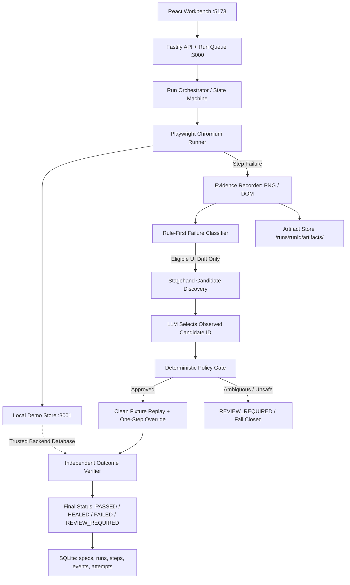

# Ojastra — Evidence-Gated Self-Healing E2E Tests

> **"The UI may change. The test's definition of correctness must not change just to make a test green."**

Ojastra is a self-healing end-to-end testing workbench. It executes known browser workflows deterministically using Playwright, detects interface drift, leverages an AI-assisted recovery adapter to propose constrained candidate actions, verifies proposed actions via deterministic policy gates, replays from clean test fixtures, and verifies the original test outcome independently.

---

## 🚀 Key Differentiators

Unlike generic AI browser agents or selector-guessing wrappers:
1. **Immutable Intent Contract:** The definition of correctness (preconditions, invariants, success assertions) is versioned and locked. AI recovery is prohibited from softening assertions or inventing arbitrary workflows.
2. **Rule-First Failure Classification:** Distinguishes harmless locator drift from real application faults, network 5xx errors, or business invariant violations before invoking recovery.
3. **Stagehand Candidate Discovery + Constrained LLM Selection:** Stagehand extracts observed page elements into an enumerated candidate list. The LLM must select from observed candidates or return `NO_SAFE_MATCH`. It never writes arbitrary selectors or executes unconstrained code.
4. **Deterministic Policy Gate:** Checks uniqueness, interactability, semantic role compatibility, attempt bounds, and sandbox risk rules before any action is executed.
5. **Clean Fixture Replay:** A proposal is never marked healed on partial state. The entire test replays from a clean baseline with one bounded step override.
6. **Independent Outcome Verifier:** Success is verified independently against both the UI confirmation page and the backend order database (SKU, quantity, tax, total, payment status, and duplicate submission checks).
7. **Refusal to Heal Real Regressions:** Seeded business logic errors (incorrect totals, payment failure, backend 503) are strictly preserved as `FAILED` (0 false heals).

---

## 🏛️ System Architecture



---

## 📁 Repository Structure

```
├── apps/
│   ├── web/                     # React + TypeScript + Vite frontend workbench (port 5173)
│   │   ├── src/views/           # Overview, ContractView, RunExplorer, MutationLab
│   │   └── src/components/      # StatusBadge, Header, etc.
│   └── api/                     # Fastify backend & SSE event stream (port 3000)
│       └── src/                 # Queue, SSE manager, REST routes
├── packages/
│   ├── contracts/               # Shared Zod schemas (TestSpec, Events, Proposals, Mutations)
│   └── engine/                  # Core test engine
│       ├── orchestrator.ts      # State machine coordinator
│       ├── playwright-runner.ts # Deterministic browser runner
│       ├── evidence-recorder.ts # Screenshots and DOM snapshots
│       ├── failure-classifier.ts# Rule-first classification
│       ├── stagehand-adapter.ts # Candidate element discovery
│       ├── llm-adapter.ts       # Structured JSON LLM recovery advisor
│       ├── recovery-policy.ts   # Deterministic gate & reason codes
│       └── outcome-verifier.ts  # Independent backend test oracle
├── demo-app/                    # Express checkout application (port 3001)
│   └── src/                     # Catalog, Cart (Version A/B), Mock Payment, Orders API
├── tests/                       # Vitest end-to-end acceptance suite
└── storage/                     # SQLite database & captured run artifacts
```

---

## ⚡ Quick Start

### 1. Prerequisites
- **Node.js**: v20+ or v24+
- **pnpm**: v9+ or v10+
- **Playwright Chromium**: installed via `npx playwright install chromium`

### 2. Setup Environment
```bash
cp .env.example .env
```
Configure your `.env` (Mistral or OpenAI compatible):
```env
PORT=3000
DEMO_PORT=3001
WEB_PORT=5173
LLM_PROVIDER=mistral
MISTRAL_API_KEY=your_key_here
LLM_MODEL=mistral-small-latest
STORAGE_DIR=./storage
DATABASE_PATH=./storage/ojastra.db
```

### 3. Install & Build
```bash
pnpm install
pnpm build
```

### 4. Run the Stack
```bash
# Starts demo-app (3001), API (3000), and Workbench Web UI (5173) concurrently:
pnpm dev
```
Open **http://localhost:5173** in your browser.

---

## 🧪 Mutation Lab Scenario Catalog

| ID | Mutation Scenario | Description | Expected Outcome |
|----|-------------------|-------------|------------------|
| `M01_RENAME_TARGET` | Rename Checkout Button | Renames `Checkout` to `Place order` and changes element ID | `HEALED` |
| `M02_RESTRUCTURE_DOM` | Restructure DOM Hierarchy | Wraps button in 3 nested generic containers | `HEALED` |
| `M03_MOVE_TARGET` | Relocate Checkout Button | Moves button to floating section below summary | `HEALED` |
| `M04_ADD_REVIEW_STEP` | Inject Review Step | Inserts uncontracted intermediate step | `REVIEW_REQUIRED` |
| `M05_DUPLICATE_LABEL` | Duplicate Action Labels | Renders two identical "Place order" buttons (Express vs Standard) | `REVIEW_REQUIRED` |
| `M06_WRONG_TOTAL` | Seed Incorrect Order Total | Backend charges $64 instead of $54 (Real Bug!) | `FAILED` |
| `M07_PAYMENT_ERROR` | Seed Mock Payment Failure | Gateway returns declined (Real Bug!) | `FAILED` |
| `M08_SERVER_UNAVAILABLE` | Force 503 Service Crash | Simulates backend database crash | `FAILED` |

---

## 🎬 5-Minute Judge Demonstration Script

1. **Baseline Execution (45s):**
   - Open Workbench at `http://localhost:5173`.
   - Click **Run Baseline Test**.
   - Observe live Playwright execution passing with **PASSED**.
   - In Run Explorer, show all 5 success conditions verified independently by test oracle.
2. **Harmless UI Drift Recovery (90s):**
   - Navigate to **Mutation Lab**.
   - Click **Run Scenario** on `M01_RENAME_TARGET` (Renames "Checkout" to "Place order").
   - Switch to **Run Explorer**:
     - Step 3 fails locator check.
     - Evidence recorder captures screenshot & DOM snapshot.
     - Classifier identifies `LOCATOR_DRIFT` (92% confidence).
     - Stagehand extracts candidates (`cand_01: Place order`).
     - LLM selects `cand_01`.
     - Policy gate approves (`UNIQUE_TARGET`, `ROLE_MATCH`, `SANDBOX_ACTION_ALLOWED`).
     - Clean fixture reset & replay succeeds with override.
     - Oracle verifies backend order state.
     - Final Status: **HEALED**.
3. **Refusal to Heal Real Regressions (60s):**
   - In Mutation Lab, click **Run Scenario** on `M06_WRONG_TOTAL` (Backend computes $64 instead of $54).
   - Observe engine strictly fails with **FAILED** (`VERIFIER_CONDITION_FAILED`).
   - Explain that Ojastra refuses to make a real defect green.
4. **Ambiguity Safe Abstention (45s):**
   - Run `M05_DUPLICATE_LABEL`.
   - Engine detects 2 identical buttons and transitions safely to **REVIEW_REQUIRED** without guessing.
5. **Empirical Benchmark Proof (30s):**
   - Open Overview KPI strip & Mutation Lab Benchmark table showing real executed sample counts (e.g. `1/1 = 100%` recovery, `0/1 = 0%` false heals).

---

## 🔬 Automated Verification Suite
Run the full automated end-to-end acceptance suite:
```bash
npx vitest run tests/e2e/workbench.test.ts
```
Expected output: **4 passed (4)**.
