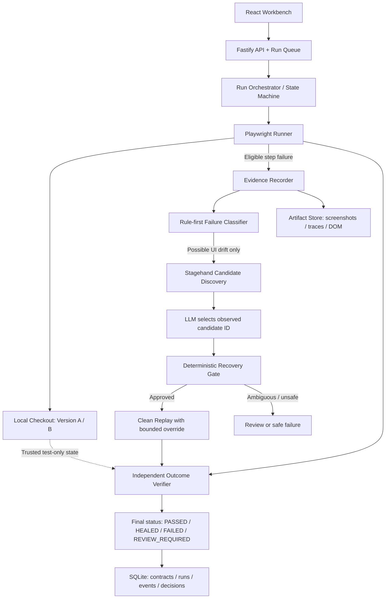

# Contents

Document Control  
01 — Executive Summary  
02 — Problem Statement  
03 — Goals, Non-Goals and Product Principles  
04 — Users and Jobs to Be Done  
05 — Scope and Priorities  
06 — Product Experience and User Journeys  
07 — Functional Requirements  
08 — System Architecture  
09 — Recovery Policy and State Machine  
10 — Data Model  
11 — API and Event Contract  
12 — Security, Privacy and Safety  
13 — Non-Functional Requirements  
14 — User Interface Specification  
15 — Evaluation and Benchmark Plan  
16 — Test Plan  
17 — Proposed Repository Structure  
18 — Build Plan and Implementation Order  
19 — Five-Minute Judge Demonstration Script  
20 — Definition of Done  
21 — Risks and Mitigations  
22 — Open Decisions and Assumptions  
23 — Official Technical References  

# Document Control

- **Product:** Ojastra
- **Document:** Product Requirements Document (PRD)
- **Version:** 1.0 — Hackathon MVP
- **Status:** Implementation baseline
- **Primary audience:** Product team, frontend/backend engineers, AI engineer, QA engineer, judges
- **Target deployment:** Local development / single-machine hackathon demo
- **Source of truth:** This PRD and the versioned test contracts stored by the application

## How to use this document

This PRD is the build contract for the hackathon implementation. Requirements marked **P0 / MUST** are necessary for the end-to-end concept to be credible. **P1 / SHOULD** items improve the demonstration if core reliability is already working. **P2 / LATER** items are explicitly not required for the first release. If implementation shortcuts conflict with test correctness or safety, correctness and safety take priority over visual polish.

# 1. Executive Summary

Ojastra is a self-healing end-to-end testing workbench. It runs known browser workflows deterministically, detects likely interface drift, asks an AI-assisted recovery adapter to propose a constrained replacement action, and verifies the original test outcome independently. It is designed to repair brittle test interactions without silently changing what the test is supposed to prove.

The product is not a general-purpose browser agent and not a chat interface wrapped around Playwright. Its key product behavior is the complete, auditable loop:

1. Execute the baseline test.
2. Capture evidence when a step fails.
3. Classify the failure before attempting recovery.
4. Discover a replacement only when the failure is plausibly recoverable UI drift.
5. Validate the proposed action using deterministic policies.
6. Replay from clean test data.
7. Verify the original contract independently.
8. Store an explanation and evidence record for the final outcome.

The demo application is a small checkout workflow with controlled Version A and Version B UI variants, a test-only order backend, and a Mutation Lab. Judges can trigger a harmless UI change and observe a successful recovery, then introduce a real business-logic failure and see Ojastra refuse to mark the test as healed.

## Product promise

**The UI may change. The test's definition of correctness must not change just to make a test green.**

## What makes this product defensible

The differentiation is not simply using an LLM, natural-language instructions, browser screenshots, or Playwright. General-purpose browser agents and automation frameworks can perform many of those tasks. Ojastra focuses on a specialized test reliability lifecycle: an immutable intent contract, evidence-gated recovery, independent outcome verification, governed repair history, and measurable performance against controlled UI mutations and real seeded regressions.

These capabilities must be implemented and measured; they must not be presented as guaranteed advantages over other products without a fair benchmark.

# 2. Problem Statement

Traditional end-to-end tests often couple a user workflow to implementation details such as CSS selectors, element IDs, or a brittle sequence of DOM assumptions. A harmless interface change can cause a test to fail even when the user journey still works. Teams then spend time diagnosing locator failures and repairing scripts.

A fully agentic alternative creates a different risk: the agent may click the wrong control, change the workflow, bypass a failing path, or report success without proving the intended business outcome. A recovery system that turns every failure into a pass undermines the purpose of testing.

Ojastra must therefore solve two connected problems:

- **Adaptability:** recover from supported, harmless interface changes without requiring developers to rewrite every affected step manually.
- **Correctness:** preserve the original intent and prevent real product defects, invalid state transitions, or ambiguous actions from being concealed by recovery.

# 3. Goals, Non-Goals and Product Principles

## 3.1 Goals

- G1. Run a predefined checkout test against Version A using Playwright.
- G2. Detect and explain an intentional locator-breaking UI change in Version B.
- G3. Use Stagehand and an LLM only on eligible recovery paths, not for every browser action.
- G4. Require structured, constrained recovery proposals and deterministic policy checks before execution.
- G5. Re-run the recovered workflow from clean test data and verify the original intent contract.
- G6. Detect seeded application regressions and refuse to report a healed pass.
- G7. Present the full lifecycle in a polished workbench with evidence and an inspectable execution timeline.
- G8. Provide a repeatable Mutation Lab and report empirical metrics across known scenarios.
- G9. Keep the architecture small enough to be implemented and demonstrated in a hackathon.

## 3.2 Non-goals for the MVP

- General-purpose autonomous website browsing.
- Support for arbitrary third-party websites or arbitrary user-provided tests without setup.
- Unrestricted LLM-generated JavaScript or code execution.
- Automatic editing of source test files or silently changing canonical test specifications.
- Distributed workers, Kubernetes, microservices, Redis, multi-tenant cloud hosting, or enterprise SSO.
- Browser coverage across every engine and device. Chromium is the first supported target.
- Real payments, real customer data, real deletion of customer data, or production-side effects.
- Custom model training, vector databases, agent swarms, or long-term autonomous memory.
- Claims of universal self-healing or guaranteed 100% test correctness.

## 3.3 Product principles

1. **Intent is immutable during recovery.** Recovery may change the execution strategy, never the approved success criteria.
2. **Deterministic-first.** Use Playwright for stable interactions and assertions. Invoke AI only when needed.
3. **Evidence before explanation.** Capture relevant browser and runtime evidence before asking the model to diagnose a failure.
4. **Propose, validate, execute.** A model proposal is not an executable command until a deterministic policy gate approves it.
5. **Outcome over action.** Clicking a button is not proof that the user goal was achieved.
6. **Fail closed.** Ambiguous, unsafe, unsupported, or unverifiable recovery ends in review or failure, never a false pass.
7. **Replayability.** Each Mutation Lab scenario must have a deterministic setup, expected result, and reset procedure.
8. **Observable behavior.** A judge or developer should be able to inspect what failed, what changed, what was proposed, and why the final status was assigned.

# 4. Users and Jobs to Be Done

## 4.1 Primary personas

### QA / test engineer
Needs to understand why a test failed, decide whether the product or test is broken, and reduce time spent repairing locators.

### Frontend / full-stack developer
Needs confidence that a UI refactor did not silently break a business workflow. Wants actionable evidence rather than a vague AI explanation.

### Engineering lead / reviewer
Needs a trustworthy signal in which false passes are treated as a serious defect. Wants to compare recovery performance across changes.

### Hackathon judge
Needs to trigger controlled changes and observe the outcome without reading the codebase or trusting a prerecorded video.

## 4.2 Core jobs to be done

- “Run this known workflow and tell me whether the intended business outcome still works.”
- “When a UI locator breaks, show me the evidence and a safe proposed replacement.”
- “Prove that the recovered workflow satisfies the same original assertions.”
- “Tell me when the problem is a genuine application failure or the evidence is ambiguous.”
- “Let me reproduce the same mutation and inspect the result.”

# 5. Scope and Priorities

## P0 — Required for a credible end-to-end MVP

- One local checkout demo with deterministic test data and a mocked payment provider.
- Version A and Version B controlled UI states.
- A typed Intent Contract with preconditions, invariants, and success conditions.
- Playwright baseline execution and explicit assertions.
- Failure evidence capture including screenshot, URL, step data, relevant logs, and Playwright trace.
- Rule-first failure classification.
- Stagehand-assisted discovery for a plausible UI-drift failure.
- LLM recovery proposal represented as validated structured data.
- Deterministic candidate/policy validation and bounded recovery.
- Replay from clean data using the candidate override.
- Independent outcome verification against the original contract and test-only backend state.
- Final run states: PASSED, HEALED, FAILED, REVIEW_REQUIRED.
- Mutation Lab with at least six repeatable scenarios.
- Run history, run detail, evidence view, and event stream in the frontend.
- Seeded regression that the system correctly refuses to heal.
- README, setup instructions, environment example, and a repeatable demo script.

## P1 — Build after the P0 vertical slice is reliable

- Human approval/rejection of proposed repair.
- A “promote repair” workflow that stores an approved reusable repair separately from the canonical intent contract.
- Comparison of two runs and mutation-level performance summary.
- Exportable JSON test report.
- Optional CI command or webhook trigger.
- Additional supported workflow mutations.

## P2 — Future product direction, not hackathon commitments

- Multi-browser/device support, distributed runners, team access control, hosted dashboard, repository integration, generalized test import, adaptive benchmark recommendations, and test-suite-wide repair analytics.

# 6. Product Experience and User Journeys

## 6.1 First-run journey

1. User opens the Ojastra workbench.
2. Overview shows the demonstration test, last run status, and available mutation scenarios.
3. User opens the saved “Complete checkout with a valid test card” test and reviews its goal and invariants.
4. User clicks **Run baseline**.
5. Workbench displays live step events and an embedded or linked view of the checkout test.
6. Test completes with PASSED and a clear set of outcome assertions.
7. User opens the run detail to inspect the timeline and evidence.

## 6.2 UI-drift recovery journey

1. User chooses **Rename checkout action** in the Mutation Lab.
2. The demo app applies a fixed Version B variant; it does not rewrite application source code at runtime.
3. User runs the same saved test.
4. The original locator fails; the test engine saves evidence and classifies the issue as a possible target/locator drift.
5. Recovery adapter inspects the page and returns bounded candidate actions.
6. LLM selects a candidate ID from that candidate list and explains the match in structured form.
7. Policy gate validates uniqueness, semantic compatibility, allowed action type, page context and risk policy.
8. Engine resets test data and replays the workflow, applying the one-step recovery override at the known failure point.
9. Verifier checks the original contract, including backend order state, correct item/quantity/total and no duplicate order.
10. Result becomes HEALED only when the complete verification succeeds. Timeline retains the original failure and recovery evidence.

## 6.3 True regression journey

1. User chooses **Introduce incorrect total** or **Force payment error**.
2. The UI target can still be found and clicked.
3. Backend response or business invariant indicates a real fault.
4. Failure classifier must not route an assertion or known functional failure into locator recovery.
5. The run ends as FAILED, with the failing invariant and supporting evidence.
6. The dashboard makes it explicit that the failure was correctly preserved—not that recovery malfunctioned.

## 6.4 Ambiguity journey

1. User chooses **Duplicate action labels**.
2. Page presents multiple plausible buttons with the same or similar name.
3. Candidate discovery returns multiple candidates or candidate uniqueness validation fails.
4. System must not click arbitrarily.
5. Run ends REVIEW_REQUIRED (or FAILED if review is not supported) with candidate context and a reason.

# 7. Functional Requirements

Priority labels: **MUST** = P0; **SHOULD** = P1 unless otherwise stated.

## FR-01 — Intent Contract Registry (MUST)

The system shall store a versioned, structured test specification independent of executable locators.

Each contract includes:
- Stable `testId` and `contractVersion`.
- Human-readable test name and goal.
- Base URL/environment identifier.
- Preconditions and fixture/setup instructions.
- Ordered workflow steps, with each step's intent and permitted action class.
- Required invariants.
- Machine-checkable success conditions.
- Allowed/forbidden side effects and risk policy.
- Data fixture identifiers, never raw secrets.
- Contract owner/creation metadata where relevant.

Acceptance criteria:
- A test can be loaded and executed without calling the LLM to reinterpret its approved contract.
- Recovery attempts reference the same contract version as the original run.
- An LLM cannot remove or soften a success condition during repair.
- Unsupported or missing critical preconditions fail validation before browser execution.

## FR-02 — Deterministic-first Playwright execution (MUST)

The engine shall execute normal steps with Playwright using resilient role/name, label, placeholder, or approved test-id locators where appropriate. AI is not used on the success path unless a supported step explicitly requires it.

Acceptance criteria:
- Baseline checkout passes without the recovery adapter being called.
- Each step emits start, success/failure, duration, and relevant evidence references.
- Navigation, action, and assertion timeouts are explicit and configurable.
- Browser errors and failed assertions are not conflated with missing locators.
- All browser actions execute in a controlled test environment.

## FR-03 — Evidence capture (MUST)

On failure, and for selected milestones, the engine shall capture:
- Run ID, test/contract version, step ID, timestamp and failure message.
- Current URL and page title.
- Screenshot and relevant DOM/accessibility snapshot or compact structured candidate evidence.
- Relevant Playwright error/trace data.
- Selected console errors and request failures, with secrets and unrelated payloads redacted.
- Last successful step and expected next state.

Acceptance criteria:
- A run detail can identify exactly which step failed and link to its saved artifacts.
- Artifact paths are stored relative to an application-controlled run directory.
- Sensitive headers, credentials, cookies, payment values and user-entered secrets are not placed in prompts or visible logs.
- Evidence capture itself failing must not cause the test to be reported as passed; record degraded diagnostics and preserve the original failure.

## FR-04 — Failure classification (MUST)

The engine shall classify failures before attempting repair. Minimum categories:
- `LOCATOR_DRIFT`
- `LAYOUT_OR_STRUCTURE_DRIFT`
- `WORKFLOW_DRIFT`
- `ASSERTION_OR_BUSINESS_INVARIANT`
- `APPLICATION_OR_NETWORK_ERROR`
- `TEST_DATA_OR_FIXTURE_ERROR`
- `ENVIRONMENT_OR_INFRASTRUCTURE_ERROR`
- `AMBIGUOUS_OR_UNKNOWN`

Implementation rule:
- Use deterministic signals first: failure type, step type, HTTP status/network state, assertion origin, current page state, and whether the expected target is absent/ambiguous.
- LLM may assist with interpretation of sanitized evidence but cannot override hard rules that classify a failed invariant or known backend error as a product/test failure.

Acceptance criteria:
- Seeded total mismatch and forced API error are not sent through locator repair as the primary remedy.
- A missing/renamed button can enter the recovery path.
- Unknown classification fails closed.

## FR-05 — Candidate discovery and recovery proposal (MUST)

When recovery is eligible, the engine shall ask Stagehand to observe the current page and discover actions relevant to the original step intent. Normalize returned information into an internal candidate schema; do not couple core business logic directly to undocumented Stagehand response fields.

Each candidate should include:
- Engine-generated candidate ID.
- Accessible role and accessible name if available.
- Description and nearby section/context.
- Supported action type.
- Locator/selector handle kept server-side.
- Visibility/enabled/uniqueness observations.
- Evidence references supporting why it was considered.

The LLM receives only the contract step, sanitized page evidence, and the enumerated candidates. It must select an existing candidate ID or return `NO_SAFE_MATCH`; it must not invent an arbitrary selector or raw code.

Acceptance criteria:
- Model output validates against a schema.
- Unknown candidate IDs are rejected.
- The model cannot supply executable JavaScript, a URL outside the allowlist, or an arbitrary locator expression.
- Recovery proposals retain original `testId`, `contractVersion`, and `stepId`.

## FR-06 — Recovery policy gate (MUST)

Before any proposed action executes, a deterministic policy gate shall check:
- Candidate ID exists and was observed in the current page state.
- Candidate remains attached/visible and is uniquely resolvable where uniqueness is required.
- Role, accessible name, nearby context and permitted action type are consistent with the target intent.
- The page is in an expected state and no blocking error was detected.
- Action is within the configured origin/environment allowlist.
- Retry and recovery attempt limits have not been exceeded.
- Risk category permits automatic action under the active test policy.

Risk policy:
- **Low:** opening a menu/tab, expanding a panel, or navigation within the local demo app. May be automatically recovered if unique and validated.
- **Medium:** editing a non-sensitive form field or modifying cart contents. Requires strong contextual match and a test fixture that can be reset.
- **High:** submitting an order, deleting data, changing credentials, or other consequential actions. Auto-execution is prohibited by default. The demo may permit the checkout submit action only within an explicitly configured sandbox, seeded test identity and mocked payment provider, with duplicate-submit safeguards and verification. This exception must not carry over to real environments.
- **Unknown:** stop for review/failure.

Acceptance criteria:
- A policy rejection is visible in the timeline with reason codes.
- The model cannot change risk level or policy configuration.
- There is at most one candidate recovery attempt per failed step in the P0 release.

## FR-07 — Replay and recovery lifecycle (MUST)

A candidate that passes initial validation is not yet a successful repair. The engine shall:
1. Save the proposal as a non-canonical recovery attempt.
2. Reset to a clean test state using a deterministic fixture/reset mechanism.
3. Replay the workflow from the beginning.
4. At the broken step, use the validated candidate mapping or bounded semantic fallback associated with that recovery attempt.
5. Execute remaining steps under the original contract.
6. Verify all original success conditions.
7. End in HEALED only when the replay and independent verification pass.

The product shall not automatically rewrite the canonical test source. The runtime recovery mapping is ephemeral until explicitly promoted through an approval workflow.

Acceptance criteria:
- A repaired action that works only from the partially completed first attempt cannot produce HEALED without clean replay.
- An invariant violation during replay results in FAILED.
- Repeated recovery attempts are bounded and recorded.
- Reset failure results in FAILED or REVIEW_REQUIRED, never HEALED.

## FR-08 — Independent outcome verifier (MUST)

The verifier shall be separate from the LLM recovery proposal logic. It shall evaluate all machine-checkable success conditions in the intent contract using trusted evidence.

For the checkout demo, verify at minimum:
- Correct seeded test user/order association.
- Expected product SKU and quantity.
- Expected total, including any configured tax/shipping rules.
- Order status equals the expected terminal status.
- Payment result is approved by the local mocked provider/test fixture.
- No duplicate order for the idempotency key or run fixture.
- UI confirmation state agrees with the backend/test oracle.

Acceptance criteria:
- A screenshot or model-generated summary alone cannot satisfy the business verifier.
- Backend/test endpoint response is validated against a schema.
- Verifier returns pass/fail for each condition, with evidence references.
- Any required condition that fails or cannot be checked prevents HEALED.

## FR-09 — Run outcome and state machine (MUST)

A run shall end with one of the following final statuses:
- `PASSED`: baseline execution succeeded and the contract passed without recovery.
- `HEALED`: baseline failed due to eligible UI drift; bounded recovery and clean replay succeeded; original contract passed.
- `FAILED`: application, assertion, fixture, infrastructure or recovery failure; or the original contract did not pass.
- `REVIEW_REQUIRED`: the engine cannot safely choose or execute a candidate, or a configured policy requires human approval.

Required intermediate states: `QUEUED`, `RUNNING`, `DIAGNOSING`, `RECOVERING`, `REPLAYING`, `VERIFYING`, plus a terminal state.

Acceptance criteria:
- Final status is assigned by backend orchestration, not frontend state or LLM output.
- Terminal status cannot be overwritten by later model messages.
- Every state transition is appended to the run event history.

## FR-10 — Mutation Lab (MUST)

Mutation scenarios shall be predefined, repeatable, and version-controlled. They must be applied as fixed test-app flags, fixtures or controlled variants, not by runtime source-code rewriting.

P0 scenario catalog:
1. `M01_RENAME_TARGET`: rename `Checkout` to `Place order` while preserving semantic purpose.
2. `M02_RESTRUCTURE_DOM`: add wrappers/change CSS classes and nesting without changing the workflow.
3. `M03_MOVE_TARGET`: move the target into a different order-summary section while retaining a unique semantic target.
4. `M04_ADD_REVIEW_STEP`: add a review step; recovery may succeed only if supported by the contract and its transition policy, otherwise it must request review.
5. `M05_DUPLICATE_LABEL`: introduce two plausible target controls; expected result is REVIEW_REQUIRED or safe failure.
6. `M06_WRONG_TOTAL`: preserve the UI but return an incorrect order total; expected result is FAILED.
7. `M07_PAYMENT_ERROR`: the test provider returns a controlled error; expected result is FAILED.
8. `M08_SERVER_UNAVAILABLE`: force a service/network error; expected result is an environment/application failure classification, not locator healing.

Acceptance criteria:
- Each scenario has setup, reset, mutation, expected outcome, and a stable scenario ID.
- Scenario can be rerun without manual database cleanup.
- Benchmark results show number of runs per scenario; no result is presented without recorded execution.

## FR-11 — Workbench UI (MUST)

Required screens:
- **Overview:** last runs, current status, measured recovery rate and failure outcomes, clearly labelled sample size/window.
- **Test Studio / Contract View:** goal, preconditions, invariants, success checks, environment and contract version.
- **Run Explorer:** event timeline, failed step, error summary, screenshot/DOM evidence references, final assertion results and recovery rationale.
- **Recovery Review:** original target, observed candidates, selected target, policy decisions, expected transition, and approval/rejection when supported.
- **Mutation Lab:** scenario picker, description, expected outcome, reset control, run button, and observed final outcome.

UI requirements:
- Minimal professional developer-tool visual language; restrained color palette, clear typography and dense but readable evidence layout.
- State is communicated with text/icon as well as color.
- Live event updates should not reorder historical events.
- The UI shall never display fabricated or preloaded run data as live results. Demo seed records, if provided, must be explicitly labelled as examples.
- All interactive controls must have real backend behavior or be visibly disabled with a clear explanation.
- Responsive enough for a laptop presentation; full browser inspector layout is desktop-first.

## FR-12 — Run history and artifact access (MUST)

The system shall persist run metadata, step events, recovery proposals, verifier results, and artifact references. Users shall be able to open a prior run and reconstruct the explanation after it completes.

Acceptance criteria:
- Refreshing the browser does not erase run status/history.
- Artifact links are served only from the application-controlled artifact store after validating the run ID/path.
- Run list can be filtered by status and mutation scenario in the MVP.

## FR-13 — Events and API (MUST)

The backend shall expose a small, typed HTTP API and Server-Sent Events (SSE) stream for live run updates.

P0 endpoint design:
- `GET /api/health` — health and version.
- `GET /api/tests` — list available intent contracts.
- `GET /api/tests/:testId` — contract detail.
- `POST /api/runs` — create a run with `testId`, contract version, environment and optional mutation scenario ID.
- `GET /api/runs` — list recent runs with status filters.
- `GET /api/runs/:runId` — run summary and final result.
- `GET /api/runs/:runId/events` — SSE event stream and historical catch-up behavior.
- `GET /api/runs/:runId/artifacts/:artifactId` — serve an authorized artifact by ID, not by raw filesystem path.
- `GET /api/mutations` — list scenarios and expected outcome descriptions.
- `POST /api/mutations/:scenarioId/reset` — reset test fixture to known state.

API rules:
- Request/response bodies validated by shared schemas.
- Return a stable run ID immediately when an accepted run is queued.
- Prevent duplicate run submissions caused by double-clicks using a client-provided idempotency key or deduplication token.
- Run-creation endpoint rejects unsupported environment origins and unknown test/scenario IDs.
- SSE reconnect should either replay stored events from a supplied event cursor or return the current snapshot plus subsequent events.
- Errors use a stable shape: `code`, `message`, optional `details`, and `requestId`; avoid leaking secrets or stack traces in production responses.

## FR-14 — Demo reset and reproducibility (MUST)

A single **Reset demo** operation shall return the application and test datastore to the baseline fixture. It must clear only demo-owned records and not touch unrelated data.

Acceptance criteria:
- Repeated reset/run/mutate cycles generate the same expected state transitions.
- Test fixtures use stable IDs and known totals.
- Each run creates an isolated run fixture or idempotency key so duplicate records can be detected.

## FR-15 — Human review and repair promotion (SHOULD)

The Run Explorer shall let a reviewer approve a retry for a uniquely observed candidate, reject the proposal, or record a clarification note. Decisions and notes are audited against the original run. Approval queues a linked child run; it is not a pass and does not bypass candidate visibility, enabled state, uniqueness, destructive-action, action-type, replay, or original contract-verification gates. The retry must freshly observe and match the reviewed target before executing it. A failed or stale match ends safely without selecting a different candidate. An approved repair may be saved as a reusable locator preference or step mapping with provenance and contract version linkage only after a clean replay and verifier pass. Human feedback must never modify the test's success conditions.

# 8. System Architecture

## 8.1 Architecture decisions

The MVP uses a **modular monolith plus one bounded run queue**. Keep one repository, one API application, one database and a local artifact directory. Do not add microservices or infrastructure that does not serve the demo.

- Frontend: React + TypeScript + Vite.
- API/orchestrator: Node.js + TypeScript + Fastify.
- Schemas: Zod in a shared package.
- Browser runner: Playwright.
- AI discovery adapter: Stagehand with one configured LLM provider.
- Persistence: SQLite.
- Binary artifacts: local files under a server-controlled `storage/runs/<runId>/` directory.
- Live updates: Server-Sent Events.
- Demo target: a local checkout app with a deterministic backend and mocked payment provider.

## 8.2 Runtime responsibilities

### Frontend workbench
Displays contracts, mutation scenarios, run states, event timeline, evidence and result report. It does not decide whether a run passed.

### API and run queue
Validates requests, enqueues bounded jobs, persists run/step/event records, starts the engine, and serves results/artifacts. For a single-machine demo, an in-process queue with concurrency 1 is preferred. It keeps Chromium resource use predictable and simplifies mutation fixture isolation.

### Test orchestrator
Owns the run state machine. It coordinates Playwright execution, classification, Stagehand discovery, model proposal validation, policy decisions, replay, and final verification.

### Playwright adapter
Owns deterministic navigation, known locators, user actions, assertions, browser timeouts, trace/screenshot creation, and low-level failure normalization.

### Stagehand adapter
Owns page observation/candidate discovery for eligible recovery cases. Stagehand response shapes are normalized into Ojastra's internal candidate contract. Core engine code must not depend directly on unverified SDK response fields.

### LLM adapter
Builds a sanitized prompt, submits a typed request, validates the structured response, records model/version/latency/token metadata where available, and maps provider errors to a recoverable diagnosis failure. The adapter must be replaceable without changing the engine's domain logic.

### Outcome verifier
Checks contract-defined UI and trusted test backend state independently of the LLM. It produces individual assertion records and an overall decision.

### Mutation fixture/controller
Activates a named UI/backend variation for the demo and restores a known baseline. It is restricted to the local demo/test environment.

## 8.3 Logical architecture diagram

The diagram separates the deterministic baseline path from the AI-assisted recovery path. All recovery decisions return to the orchestrator, while the outcome verifier remains independent of the LLM proposal.



## 8.4 Browser integration spike — required before locking dependencies

Stagehand's official v3 documentation describes use of Playwright `Page` objects with Stagehand `act`, `extract`, and `observe` methods, including a documented CDP connection option. Because SDK APIs and browser ownership may change, implement a small spike before the main recovery engine:

1. Pin compatible `@browserbasehq/stagehand`, `playwright`/`playwright-core`, Node.js, and model SDK versions.
2. Start a local Chromium instance and navigate to the demo checkout.
3. Invoke Stagehand observation on the same page used by Playwright.
4. Normalize the returned candidate data and verify target mapping.
5. Execute one approved action and capture a Playwright trace.
6. Verify cleanup closes browser/session resources.
7. Record the exact known-good versions and setup command in README and lockfile.

Do not build two independent browser sessions for a single run. Choose one ownership model and encapsulate it in the adapter. The recommended goal is one page/context that Playwright can control and Stagehand can inspect through the supported integration. If the pinned SDK requires a different bootstrapping model, update only the adapter and retain the same engine contract.

## 8.5 High-level data flow

1. UI posts a run request.
2. API validates the test ID, contract version, environment and mutation scenario; creates a run record and QUEUED event.
3. Queue worker loads immutable contract and clean fixture configuration.
4. Playwright executes known steps and stores step events.
5. On failure, the orchestrator saves evidence and calls the classifier.
6. Nonrecoverable classes route to final failure/review handling.
7. Eligible UI drift calls Stagehand discovery and the LLM adapter.
8. Recovery policy gates the selected candidate.
9. Approved recovery causes reset and replay with one bounded step override.
10. Independent verifier checks the original contract.
11. Orchestrator writes final status, metrics, evidence references and terminal event.
12. SSE streams events to the workbench; run detail remains available after refresh.

# 9. Recovery Policy and State Machine

## 9.1 Core state machine

```text
QUEUED -> RUNNING
RUNNING -> PASSED                         (baseline and verifier pass)
RUNNING -> DIAGNOSING                     (eligible step failure)
DIAGNOSING -> FAILED                      (hard failure / invariant broken)
DIAGNOSING -> RECOVERING                  (plausible UI drift)
RECOVERING -> REVIEW_REQUIRED             (ambiguous / unsafe / unsupported)
RECOVERING -> REPLAYING                   (proposal passes policy)
REPLAYING -> VERIFYING
VERIFYING -> HEALED                       (full original contract passes)
VERIFYING -> FAILED                       (contract or replay fails)
Any non-terminal state -> FAILED         (unhandled error / cancellation policy)
```

Terminal states cannot transition to another terminal state. Any manual rerun creates a new run linked to the prior run rather than mutating the previous result.

## 9.2 Proposal format

The LLM must select from the currently observed candidates. Example schema (illustrative, not a promise of a specific SDK return shape):

```json
{
  "decision": "SELECT_CANDIDATE",
  "targetCandidateId": "cand_03",
  "actionType": "click",
  "expectedTransition": "review_to_confirmation",
  "rationale": "Unique Place order control inside the order summary matches the intended checkout action.",
  "evidenceRefs": ["artifact_dom_02", "artifact_screenshot_02"]
}
```

Allowed `decision` values: `SELECT_CANDIDATE`, `NO_SAFE_MATCH`. Allowed action types should be limited to the operations needed for the demo (`click`, `fill`, `select`, `press`, and, only if justified, a safe navigation/scroll operation). A candidate is bound to the observed page state and invalidated if the page changes before execution.

The model must never provide executable code, raw shell commands, arbitrary filesystem paths, arbitrary browser scripts or unbounded navigation targets.

The semantic auto-acceptance threshold is configured once by the API (`MIN_CANDIDATE_SIMILARITY`, default `0.85`) and applied to candidates from every proposal provider. Scores below the threshold require an explicit human review decision; failure-classifier confidence is a separate metric and must not be substituted for candidate similarity.

## 9.3 Recovery decision rules

- Do not run locator repair for failed business assertions, known backend 4xx/5xx failures, test fixture reset failures, or detected infrastructure outages.
- If no relevant target candidate exists, return `NO_SAFE_MATCH` and stop.
- If more than one materially plausible candidate exists, require review or fail safely.
- Use evidence from the current page state only; discard stale candidates after navigation or DOM mutation.
- Use exactly one recovery proposal per failed step in the P0 release.
- A recovery proposal must include expected next-state intent. After action execution, a deterministic check must confirm the expected transition.
- Replaying uses clean fixtures and the same contract version. The first partial run is diagnostic evidence, not proof of success.
- Any original invariant failure takes precedence over the healing result.

# 10. Data Model

The schema may be implemented with SQLite and a lightweight query layer. Prefer explicit relational records over one opaque JSON blob, while keeping contract definitions and event payloads as validated JSON where flexibility is useful.

## 10.1 Core entities

### `test_specs`
- `id` (primary key)
- `slug` (unique)
- `name`
- `description`
- `active_contract_version`
- `created_at`, `updated_at`

### `test_contract_versions`
- `id` (primary key)
- `test_id` (foreign key)
- `version`
- `contract_json`
- `content_hash`
- `created_at`
- Unique `(test_id, version)`

### `test_runs`
- `id` (UUID/ULID)
- `test_id`, `contract_version`
- `status`
- `trigger_source` (`workbench`, `cli`, later `ci`)
- `mutation_scenario_id` nullable
- `started_at`, `finished_at`, `duration_ms`
- `final_summary`
- `error_code` nullable
- `recovery_count`
- `idempotency_key`
- `parent_run_id` nullable, for linked comparisons/retries

### `run_steps`
- `id`
- `run_id`
- `step_id` from contract
- `attempt_number`
- `status`
- `started_at`, `finished_at`, `duration_ms`
- `failure_category` nullable
- `error_summary` nullable
- `input_redacted_json` nullable
- `output_summary_json` nullable

### `recovery_attempts`
- `id`, `run_id`, `step_id`
- `candidate_set_json`
- `proposal_json`
- `policy_decision` (`APPROVED`, `REJECTED`, `REVIEW_REQUIRED`)
- `policy_reason_codes_json`
- `model_name`, `model_latency_ms` nullable
- `created_at`
- `replay_run_id` nullable or linked replay identifier
- `result_status` nullable

### `evidence_artifacts`
- `id`, `run_id`, `step_id` nullable
- `artifact_type` (`screenshot`, `trace`, `dom_snapshot`, `console_log`, `network_summary`, `verifier_report`)
- `relative_path`
- `mime_type`
- `sha256` optional
- `created_at`
- `redaction_status`

### `run_events`
- `id` or monotonic per-run sequence
- `run_id`
- `sequence_no`
- `event_type`
- `timestamp`
- `payload_json`
- Unique `(run_id, sequence_no)`

### `mutation_scenarios`
- `id`, `name`, `description`
- `mutation_type`
- `expected_outcome`
- `setup_config_json`
- `enabled`

## 10.2 Data retention

For hackathon/local use, retain run history until the user resets demo data or removes the local storage. Document the reset behavior. A future hosted product would need configurable retention and team/project boundaries.

# 11. API and Event Contract

## 11.1 Create-run request

```json
{
  "testId": "checkout-valid-card",
  "contractVersion": 1,
  "environmentId": "local-demo",
  "mutationScenarioId": "M01_RENAME_TARGET",
  "idempotencyKey": "client-generated-unique-key"
}
```

The server validates every field and responds with `202 Accepted` and `runId` after the request is durably queued.

## 11.2 Example run event

```json
{
  "sequence": 12,
  "runId": "run_01J...",
  "type": "RECOVERY_CANDIDATE_SELECTED",
  "timestamp": "2026-10-11T00:00:00.000Z",
  "payload": {
    "stepId": "submit-order",
    "candidateId": "cand_03",
    "policyDecision": "APPROVED",
    "reasonCodes": ["UNIQUE_TARGET", "ROLE_MATCH", "SANDBOX_ACTION_ALLOWED"]
  }
}
```

Use stable, versioned event types. Do not put credentials, cookies, full payment values, authorization headers or unnecessary personal data in event payloads.

## 11.3 Required event types

`RUN_QUEUED`, `RUN_STARTED`, `STEP_STARTED`, `STEP_PASSED`, `STEP_FAILED`, `EVIDENCE_CAPTURED`, `FAILURE_CLASSIFIED`, `RECOVERY_STARTED`, `RECOVERY_CANDIDATES_FOUND`, `RECOVERY_PROPOSED`, `RECOVERY_POLICY_DECIDED`, `REPLAY_STARTED`, `VERIFICATION_STARTED`, `VERIFICATION_CHECK_PASSED`, `VERIFICATION_CHECK_FAILED`, `RUN_FINISHED`, `RUN_FAILED`, `REVIEW_REQUIRED`.

The UI should render a human-readable summary from these events while retaining the structured payload for a details drawer.

# 12. Security, Privacy and Safety

Even though the hackathon target is local, the architecture should prevent unsafe patterns by default.

- API keys live only in server-side environment variables; never use a `VITE_` prefix for secrets.
- Use a checked-in `.env.example` with empty placeholders; exclude `.env` from source control.
- Limit browser execution to the local demo origin unless an explicit trusted environment is configured.
- Never allow arbitrary external URLs or arbitrary script execution from model output.
- Sanitize DOM evidence before passing it to the model. Remove form values that could contain secrets, cookies, tokens, authorization headers and irrelevant personal data.
- Do not transmit browser storage, complete network bodies, or payment credentials to the LLM by default.
- Mock payment and use seeded synthetic customer/order data.
- Enforce timeouts, run concurrency limits, artifact size limits and a maximum recovery attempt count.
- Serve artifacts by database artifact ID, not by a user-controlled filesystem path. Normalize paths and reject traversal attempts.
- Escape rendered logs and model output to prevent HTML/script injection in the workbench.
- Treat webpage text as untrusted data; page content must never override system rules or tool policy. This mitigates prompt injection from web content.
- Record a clear audit trail for recovery proposals and decisions.
- The Mutation Lab reset only affects its own test fixture/database namespace.
- Use a safe failure state if the model provider is unavailable, malformed output is returned, or the Stagehand adapter cannot observe the page.

# 13. Non-Functional Requirements

## Reliability
- Only the backend orchestrator assigns final status.
- All runs have bounded action, model, replay and total-run timeouts.
- A run worker serializes access to the demo fixture; MVP concurrency defaults to one.
- Browser/page cleanup runs in `finally` blocks even after exceptions.
- Every terminal run has a persisted final event and a final summary.

## Performance (initial targets)

These are hackathon design targets and must be measured; they are not external guarantees.
- API health/list/detail requests: p95 under 300 ms on a normal local laptop, excluding artifact transfer.
- Queued run starts within 2 seconds when no other run is active.
- Ordinary baseline checkout completes within 15 seconds under local demo conditions.
- Recovery path completes within 60 seconds in the typical successful case, excluding provider outages.
- UI receives a run event within 1 second of backend persistence under normal local conditions.

## Usability and accessibility
- Keyboard-accessible primary actions and focus indicators.
- Contrast and non-color labels for statuses.
- Visible loading, empty, success, fail and review states.
- Error messages include a next useful action or the reason the system stopped.
- A judge can trigger the three core scenarios without editing source code or environment variables.

## Maintainability
- TypeScript strict mode for app and engine code.
- Shared schemas for API, model proposals and events.
- Unit tests for classification, state transitions, action policy and verifier logic.
- Lockfile committed; known-good dependency versions pinned.
- CI or local validation runs lint/typecheck/unit tests before demo build.

# 14. User Interface Specification

## 14.1 Visual direction

The workbench should feel like a focused engineering tool: restrained neutral background, dense but legible information, strong hierarchy, small accent colors used only for meaningful state, precise alignment, and minimal decorative gradients or AI-themed imagery. Prefer a left navigation rail and content canvas with a clear evidence panel. Avoid a chatbot-first layout.

## 14.2 Overview

Components:
- Top bar with Ojastra mark, active environment, connection/run status.
- Compact KPI strip: runs in selected window, healed runs, failed runs, measured benign recovery rate. Each metric includes sample count and date/window.
- Recent runs table: test name, mutation, status, duration, time, and recovery count.
- Primary action to open Mutation Lab/run a selected test.
- Empty state with a clear “Run baseline” CTA.

## 14.3 Test Studio / Contract View

Show goal, preconditions, allowed action types, invariants and success conditions. Include contract version and a lock/immutable-during-run indication. A user can inspect the test definition. Editing the canonical contract is separate from a recovery proposal and creates a new contract version.

## 14.4 Run Explorer

Desktop layout:
- Left pane: chronological step timeline with status and duration.
- Center pane: screenshot/current page evidence with before/after toggle when available.
- Right pane: selected step explanation, failure classification, candidate and policy details, assertion results.

Requirements:
- Original failure remains visible for HEALED runs.
- Each evidence item has timestamp, step ID and artifact type.
- “Why did it fail?”, “Why was this candidate selected?” and “What proves success?” are answered with persisted facts and evidence references, not a fresh unconstrained LLM narrative.

## 14.5 Mutation Lab

Each scenario card shows mutation name, what it changes, expected system behavior, risk category, and a button to activate/reset/run. The expected result is visible to make evaluation reproducible, but the final observed result remains separate. Example: “Expected: FAILED — wrong total; observed: HEALED” must be presented as a benchmark failure, not disguised as success.

## 14.6 Visual state language

- PASSED: neutral/green success treatment plus explicit text.
- HEALED: distinct success state with recovery icon and original failure preserved.
- FAILED: red/danger state with failure class.
- REVIEW_REQUIRED: amber/warning state with reason for stopping.
- RUNNING/RECOVERING: subdued progress indicator; no fabricated percentage if the engine cannot calculate one.

# 15. Evaluation and Benchmark Plan

## 15.1 Required metrics

- **Benign mutation recovery rate** = correctly healed supported benign mutations / total supported benign mutation runs.
- **False-heal rate** = seeded genuine-defect runs incorrectly reported as HEALED or PASSED / total seeded genuine-defect runs.
- **Intent preservation rate** = recovered runs that satisfy every unchanged required contract condition / attempted recoveries.
- **Safe abstention rate** = ambiguous/unsafe cases correctly routed to REVIEW_REQUIRED or FAILED / all ambiguous/unsafe cases.
- **Recovery latency** = time from initial eligible failure to terminal result.
- **Model invocation rate** = runs with model invocation / all runs; baseline should not require AI.
- **Cost per recovery** = provider cost or token estimate per recovery, when usage data is available.
- **Reproducibility** = repeated scenario runs with same expected classification and contract outcome / repeated runs.

## 15.2 Initial acceptance targets

- 100% of baseline checkout runs pass in the known-good environment.
- At least 90% recovery across the defined, supported benign mutation suite after the integration is stable.
- 0 false passes across the seeded wrong-total/payment-error test cases in the acceptance suite.
- 100% of HEALED runs pass every required contract condition on clean replay.
- 100% of duplicate/ambiguous-candidate cases in the benchmark stop safely rather than choosing arbitrarily.
- Every terminal run has an inspectable event history and linked evidence, subject to explicitly recorded capture failures.
- Re-running the same fixed scenario produces the same expected classification in the controlled demo environment.

Targets apply only to the documented benchmark set. Report counts with rates; for example, `9/10 = 90%`, not a percentage without sample size. Do not claim production-grade reliability from a small hackathon set.

## 15.3 Evaluation protocol

1. Reset data and browser state.
2. Activate exactly one versioned mutation scenario.
3. Run the saved contract.
4. Save result and evidence.
5. Compare actual outcome with the predefined expected outcome.
6. Repeat each scenario at least five times during development to identify flakiness; for the final demo, show the actual executed sample count.
7. Report false passes separately from ordinary recovery failures. False passes have higher severity.

# 16. Test Plan

## Unit tests
- Contract validation rejects missing goal/invariants/success conditions where required.
- State machine prevents invalid transitions and terminal state rewrites.
- Candidate validation rejects unknown IDs, stale candidate tokens, ambiguous duplicates and disallowed actions.
- Failure classifier does not route known assertion or backend errors to locator recovery.
- Policy gate applies environment allowlist, risk rules and attempt limits.
- Verifier fails when order total, SKU, quantity, status or duplicate-order condition is wrong.
- Artifact path resolver blocks traversal and only serves registered artifact IDs.

## Integration tests
- Playwright runner can execute Version A with the expected result.
- Stagehand adapter can inspect the same page/context under the pinned integration.
- Model adapter parses a valid proposal and rejects malformed/extra fields.
- Recovery pipeline discovers renamed target and creates a valid replay override.
- Reset returns fixtures to known state.
- SSE emits persisted events in sequence and reconnects successfully.

## End-to-end acceptance tests
- Baseline checkout -> PASSED.
- Renamed checkout target -> HEALED after verified replay.
- DOM re-structure -> HEALED if candidate remains unique and supported.
- Workflow step change -> review or recovery according to explicit supported contract; never silently skip required confirmation.
- Duplicate labels -> REVIEW_REQUIRED/FAILED.
- Wrong order total -> FAILED.
- Mock payment error -> FAILED.
- Server unavailable -> infrastructure/application classification; no locator-healing loop.
- Provider unavailable or invalid model output -> safe stop; no arbitrary fallback action.
- Reset, run, inspect, refresh and rerun -> persisted traceable result.

# 17. Proposed Repository Structure

```text
Ojastra/
  apps/
    web/
      src/
        pages/overview/
        pages/tests/
        pages/run-detail/
        pages/mutation-lab/
        components/
        api/
    api/
      src/
        routes/
        queue/
        events/
        server.ts
  packages/
    contracts/src/
      test-spec.schema.ts
      recovery-proposal.schema.ts
      run-event.schema.ts
    engine/src/
      orchestrator.ts
      state-machine.ts
      playwright-runner.ts
      evidence-recorder.ts
      failure-classifier.ts
      stagehand-adapter.ts
      llm-adapter.ts
      recovery-policy.ts
      recovery-planner.ts
      outcome-verifier.ts
      mutation-controller.ts
  demo-app/
    checkout/
    fixtures/
  tests/
    unit/
    integration/
    e2e/
    mutation-benchmark/
  storage/                 # ignored by git; generated at runtime
  .env.example
  package.json
  pnpm-lock.yaml or package-lock.json
  README.md
```

This is a target layout, not a reason to over-split the first commit. Keep modules separate by responsibility, but do not create package boundaries unless they aid reuse or type safety.

# 18. Build Plan and Implementation Order

## Phase 0 — Integration spike and repo skeleton

Deliverables:
- Decide package manager and Node version.
- Pin Playwright, Stagehand and model-provider versions.
- Verify Stagehand observation works with the selected local Chromium + Playwright page/context.
- Verify screenshot/trace artifacts can be saved and reopened.
- Add config validation and `.env.example`.

Exit criteria: one tiny script opens the local checkout, observes a target and performs one approved test action; cleanup is reliable.

## Phase 1 — Deterministic checkout vertical slice

Deliverables:
- Checkout UI, seeded user/product/cart and mocked payment backend.
- Version A and baseline Playwright test.
- Intent Contract and verifier.
- Run records and deterministic final states.

Exit criteria: baseline pass and wrong-total fail both work before AI recovery exists.

## Phase 2 — Evidence and event lifecycle

Deliverables:
- Run queue with concurrency one.
- Per-step events, screenshot and trace capture.
- Failure classification and run history API.
- SSE stream with reconnect semantics.

Exit criteria: a failed run can be explained from persisted data after a browser refresh.

## Phase 3 — Bounded recovery loop

Deliverables:
- Stagehand adapter and candidate normalizer.
- Structured LLM proposal schema.
- Policy gate and reason codes.
- One-step recovery override and clean replay.

Exit criteria: renamed target heals; ambiguous target stops; wrong total remains failed.

## Phase 4 — Mutation Lab and benchmark

Deliverables:
- Fixed scenario catalog and reset button.
- Seeded application fault toggles.
- Metric computation from actual run records.
- Repeatability scripts and acceptance test suite.

Exit criteria: each P0 mutation has deterministic setup and expected outcome, and the UI reports actual observed results.

## Phase 5 — Workbench polish and demo hardening

Deliverables:
- Overview, Contract View, Run Explorer, Recovery Review, Mutation Lab.
- Responsive laptop presentation layout.
- Empty/loading/error states.
- No dead controls or fabricated progress.
- README, architecture diagram, setup script and demo script.

Exit criteria: a teammate can clone the repo and reproduce the whole judge demo using documented steps.

## Priority rule

If time is short, deliver Phases 0–4 with a simple but truthful UI before spending time on animation or advanced dashboard polish. The recovery proof and false-pass protection are the product; the UI makes that proof understandable.

# 19. Five-Minute Judge Demonstration Script

1. **Baseline (45 sec):** Run Version A. Show PASSED and the contract checks for SKU, quantity, total and mocked payment.
2. **Break the UI (45 sec):** Activate `M01_RENAME_TARGET`. Show that the original locator fails; do not hide the failure event.
3. **Observe recovery (90 sec):** Show Stagehand candidate discovery, structured LLM proposal, policy decision and selected evidence. Make clear that the model proposed a candidate rather than deciding final test success.
4. **Prove the result (45 sec):** Show clean replay, the backend verifier and HEALED outcome while preserving the original failed step in the timeline.
5. **Expose a real bug (45 sec):** Activate `M06_WRONG_TOTAL` or `M07_PAYMENT_ERROR`. Show FAILED and the violated condition. Explain that recovery is not allowed to make a business assertion pass.
6. **Show measurement (30 sec):** Open benchmark summary with actual scenario counts, observed statuses and any limitations.

The script must use live execution. If a provider/network dependency is needed, rehearse a documented failure mode. Do not replace a failed live run with a fabricated success record.

# 20. Definition of Done

The hackathon MVP is done only when all of the following are true:

- [ ] A clean checkout works from documented installation steps.
- [ ] Stagehand integration is verified against pinned versions and a single page/context.
- [ ] Intent contract is versioned and cannot be changed by recovery.
- [ ] Baseline Playwright test passes without using the LLM.
- [ ] Renamed target fails before recovery and can be healed through the complete replay path.
- [ ] Wrong-total and payment-error scenarios remain failures.
- [ ] Ambiguous candidate scenario stops safely.
- [ ] Final run status comes only from the backend state machine and verifier.
- [ ] Every run has persisted events, evidence references and final verifier results.
- [ ] UI refresh does not lose the current run/history.
- [ ] Mutation scenarios are deterministic and resettable.
- [ ] Benchmark metrics are computed from actual stored results, with sample sizes displayed.
- [ ] API keys and secrets are not committed or exposed in the frontend.
- [ ] No arbitrary LLM-generated JavaScript is executed.
- [ ] README explains the differentiator, architecture, setup, environment variables, test commands, mutations, known limitations and demo flow.
- [ ] All P0 acceptance tests pass on the final build.

# 21. Risks and Mitigations

- **Stagehand SDK behavior changes** — *Impact:* Integration delays or breakage. *Mitigation:* Pin versions, implement a narrow adapter, and run the Phase 0 spike first.
- **LLM returns malformed or overconfident output** — *Impact:* Invalid or unsafe action. *Mitigation:* Schema validation, candidate IDs only, deterministic policy, and safe abstention.
- **UI drift is confused with a genuine bug** — *Impact:* False green test. *Mitigation:* Classify before healing, separate assertion/network failures, and use an independent backend verifier.
- **Recovery succeeds only in a partially completed session** — *Impact:* Hidden state dependency. *Mitigation:* Reset fixtures and replay from clean state before assigning HEALED.
- **Duplicate checkout caused by retries** — *Impact:* Incorrect side effects. *Mitigation:* Use test-only idempotency keys, isolated fixtures, and duplicate-order assertions.
- **LLM latency makes the demo slow** — *Impact:* Poor judge experience. *Mitigation:* Invoke AI only on failures, bound timeouts, show actual progress, and surface provider errors.
- **Artifact contains secrets or untrusted HTML** — *Impact:* Data exposure or XSS. *Mitigation:* Redaction, synthetic data, artifact IDs, path confinement, and escaped output.
- **Demo mutations are not reproducible** — *Impact:* Results cannot be trusted. *Mitigation:* Version-controlled mutations, fixed fixtures, deterministic reset, and repeated benchmarks.
- **Product looks like a generic AI dashboard** — *Impact:* Weak differentiation. *Mitigation:* Lead with failure → repair → proof, before/after evidence, and honest benchmark outcomes.
- **Scope creep** — *Impact:* Incomplete core loop. *Mitigation:* Enforce P0/P1/P2 priorities and complete one vertical slice before extra features.

# 22. Open Decisions and Assumptions

The PRD makes these assumptions to keep implementation unblocked:

- The demo target is a repository-owned local checkout app, not an arbitrary external website.
- Chromium is the only browser target for the MVP.
- A single LLM provider is configured through a server-side adapter; the exact model is selected during the integration spike based on structured-output quality, latency and available access.
- Stagehand is an AI-assisted discovery/recovery component, not the source of truth for test outcomes.
- The demo payment flow is mocked and uses only synthetic data.
- The first release is local/single-user; authentication and multi-tenant isolation are out of scope.
- The supported structural workflow-change behavior is explicitly limited. If a new step cannot be reconciled with the current contract without ambiguity, the correct result is REVIEW_REQUIRED, not automatic workflow invention.
- Numeric performance targets are initial engineering goals to measure, not guarantees.

## Decisions required during Phase 0

1. Confirm the package manager and Node.js version supported by the selected Stagehand release.
2. Confirm the Stagehand v3 + Playwright browser ownership strategy and add an integration test.
3. Select the LLM provider/model and define timeout/token limits.
4. Confirm whether the checkout order backend is a tiny server route or an isolated demo service; prefer same application unless separation materially improves deterministic testing.
5. Confirm the first acceptance benchmark seeds and expected outcomes before tuning the model.

# 23. Official Technical References

The following official documentation informs the implementation approach. Pin dependencies and recheck the current documentation when implementation begins because SDK versions and APIs may evolve.

1. **Stagehand v3 — Playwright integration:** documents passing Playwright `Page` objects into Stagehand AI methods and its browser connection pattern. https://github.com/browserbase/stagehand/blob/main/packages/docs/v3/integrations/playwright.mdx
2. **Stagehand introduction:** describes the code-plus-AI approach and the `act`, `extract`, and `observe` primitives. https://github.com/browserbase/stagehand/blob/main/packages/docs/v3/first-steps/introduction.mdx
3. **Playwright assertions:** documents auto-retrying web assertions and recommended assertion patterns. https://playwright.dev/docs/test-assertions
4. **Playwright Trace Viewer:** describes recording and inspecting actions, page snapshots, screenshots, console/network activity and test reports. https://playwright.dev/docs/trace-viewer-intro
5. **Playwright tracing API:** explains trace recording and cautions about lower-level tracing not recording test assertions. https://playwright.dev/docs/api/class-tracing
